<h1 align="center">Red Tune</h1>

<p align="center">
  <b>One control panel for AMD Ryzen laptops.</b><br>
  Power limits and presets, fan curves, a per-core voltage curve with an automatic tune,<br>
  graphics card tuning, a system-wide sound effect, every display, memory timings, clean-up — with one look.
</p>

<p align="center">
  <a href="https://github.com/monimanpro/RedTune/releases/latest"></a>
  
  
  
  
</p>

<p align="center">
  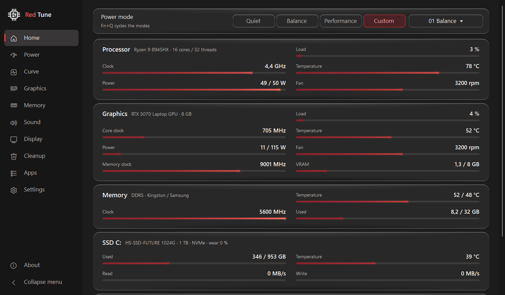
</p>

Red Tune reads the hardware when it starts and shows only the pages that fit the machine. It is aimed at laptops with Ryzen 5000 to 9000 series processors of any brand; desktop PCs with a Ryzen processor run it in a generic mode.

> **Warning.** Red Tune changes processor, graphics card, memory and firmware settings. Wrong values can crash the computer, corrupt data or keep it from starting. You use it at your own risk. If something went wrong, hold **Shift** while Red Tune starts: it then applies nothing.

## What it does

### Home
Load, clocks, temperatures, fan speeds and power («now / limit») of the processor, the graphics card and memory; a card per drive; the power mode switch.

### Power
Presets of your own power mode, each holding everything below, with step back and forward (Ctrl+Z / Ctrl+Y). A press on a slider's track puts the pointer onto its knob, and the drag goes from there. The page has five tabs.

- **Processor** — power limits (sustained, short, peak), temperature limit, current limits. On laptops whose firmware offers a tuning interface the limits go through it; elsewhere they are written straight to the processor's management unit (PPT, TDC, EDC, or STAPM / fast / slow on mobile chips).
- **Graphics card** — the card's power and temperature limits where the firmware exposes them, and which graphics preset goes with the power preset.
- **Fans** — your own fan curves by temperature: one per fan or one for both, with a safety net (a critical temperature always wins), hysteresis and smoothing.
- **Power plans** — which Windows power plan belongs to each mode, and the plan's processor settings in one place: clock ceiling, boost mode, energy preference, minimum state, core parking, the plan's kind, and the Windows power mode laid over balanced plans.
- **Curves** — which voltage curve belongs to each mode.

<table>
  <tr>
    <td width="50%">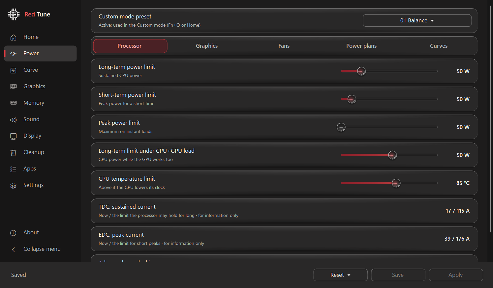</td>
    <td width="50%">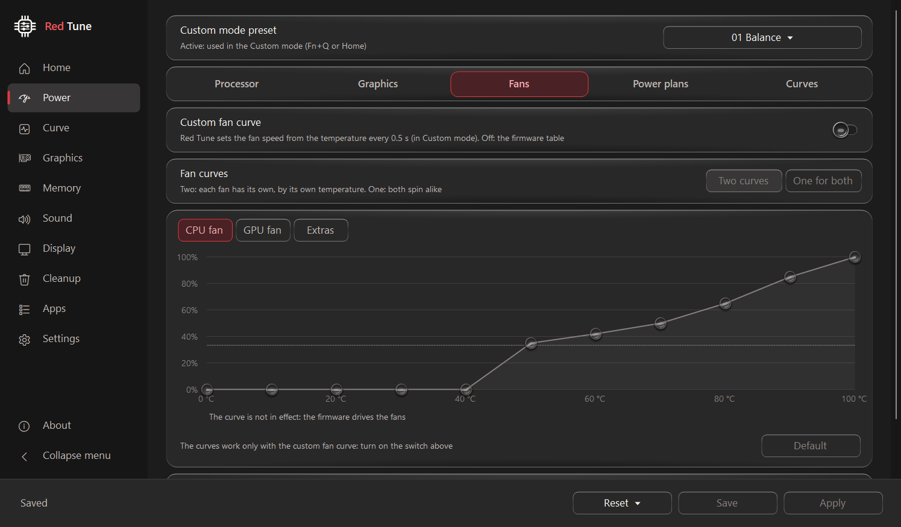</td>
  </tr>
</table>

### Curve
The Curve Optimizer value of every core, on any number of cores and chiplets: sliders, presets, history, and what to apply when Windows starts.

- **Auto-tune** finds values by itself. It loads the cores (its own load written for this, or Prime95 if you point to it), watches the hardware error records Windows keeps, steps back from the values that fail and leaves a margin. Two modes: *daily* (deeper, a value per core) and *strict* (holds whatever set of cores is busy, noticeably shallower). A run survives restarts: after a crash it goes on from where it stopped.
- **Watchdog** reads the processor's corrected-error records once a minute and advises which core to raise; it never writes without your button.

<table>
  <tr>
    <td width="50%">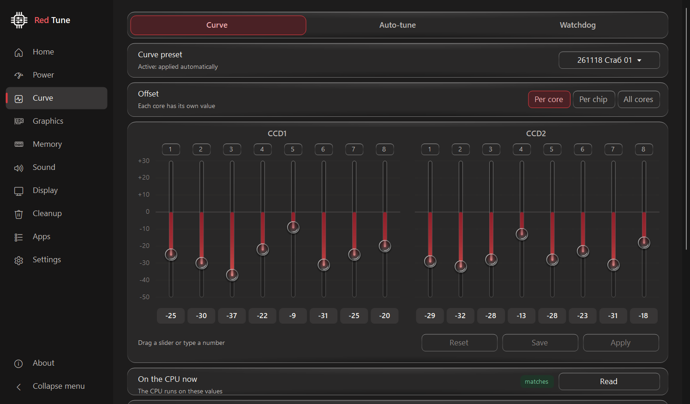</td>
    <td width="50%">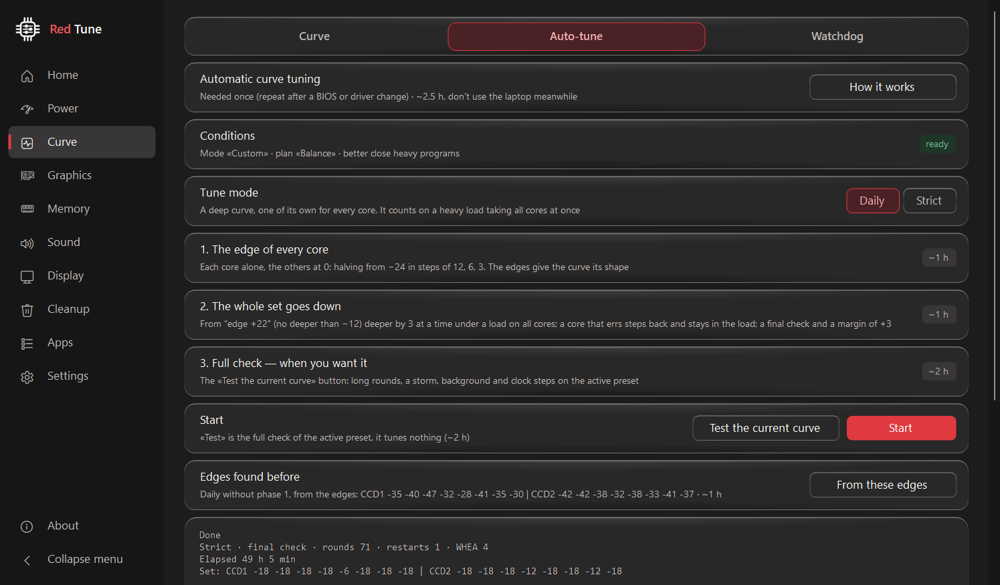</td>
  </tr>
</table>

### Graphics card (NVIDIA)
The card's voltage/clock curve as points you drag, a memory clock offset, presets, step back and forward (Ctrl+Z / Ctrl+Y), and automatic apply with a power preset.

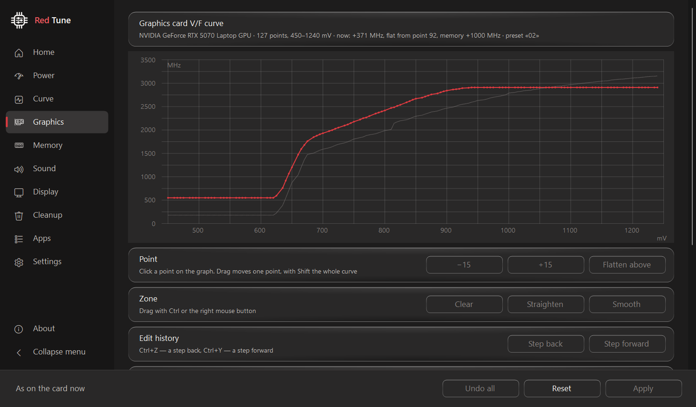

### Sound
A sound effect of Red Tune's own that Windows runs for every program on the output device or the microphone you pick.

- **Equalizer** — 12 bands (bell, shelves, cuts, notch) drawn as a curve over the live spectrum; points are dragged, strips beside the plot give the same bands as faders and dials, with a slope dial for each: cuts from 12 to 48 dB per octave, steeper shelves, a bell that flattens into a plateau.
- **Compressor** — in one, two or three frequency bands, each with its own threshold, ratio, knee, attack, release and make-up gain. A picture shows the transfer curve with draggable points, eight dials, and a monitor that is either the last ten seconds or the bands across the frequencies with their live levels. Bands can be soloed and muted for listening. Four characters (clean, FET, optical, tube) change how it reacts; an optional colour (tube, transistor, tape, transformer) adds harmonics, oversampled four times; a mix control gives parallel compression.
- **Limiter** — a look-ahead limiter that measures the true peak of the wave, so the output never passes the ceiling and does not rasp.
- **Microphone** — a chain for the input: a pre-compressor, a gate, noise suppression (RNNoise or DeepFilterNet 3), a reverb remover, the equalizer, a de-esser, the compressor and the limiter. Every program that records from that microphone (calls, streaming, recording) gets the processed sound; a switch lets you hear yourself.
- Presets, settings per device, step back and forward, a level meter, and a switch for a laptop maker's own sound effects that would otherwise add to Red Tune's.

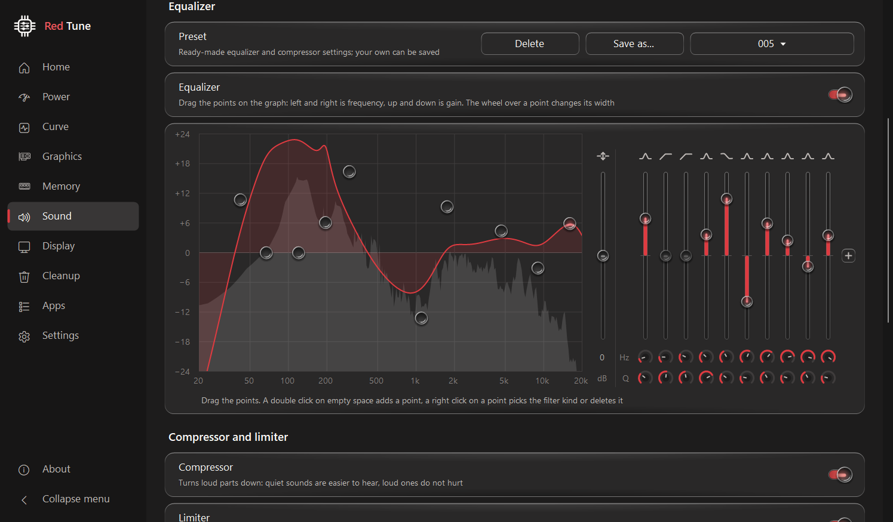

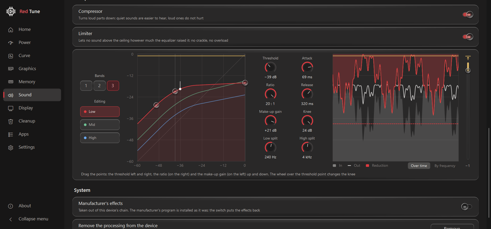

### Display
A tab per screen, the laptop's own and every monitor; the settings above the tabs are for all of them.

- **Brightness** — the built-in screen through Windows, an external monitor through DDC/CI (as its own buttons do).
- **Resolution, refresh rate, scale** — a monitor's «60 Hz» that really runs at 59.95 is shown and set as 60.
- **Colour profile** — the profiles Windows applies to the screen, including the ones a laptop maker measured for its panel (sRGB, DCI-P3, Display P3 …); a profile made for another screen is flagged. Profiles can be added from a file.
- **HDR** and **automatic colour management** told apart. Windows switches automatic colour management on by itself for 10-bit screens; it maps everything through what the monitor reports of its colours, and a monitor that reports them wrongly gets a colour cast. Turned off on the page, it is kept off for that monitor on every cable.
- **Signal** — what goes down the cable: RGB or YCbCr and the bits per channel.
- **Main monitor**, the screen mode of Win+P, the panel's overdrive on supported laptops, the built-in screen's refresh rate following the power source (high on mains, low on battery), one brightness for all power plans, and the displays off (Red Tune wakes them at the first key or mouse move).

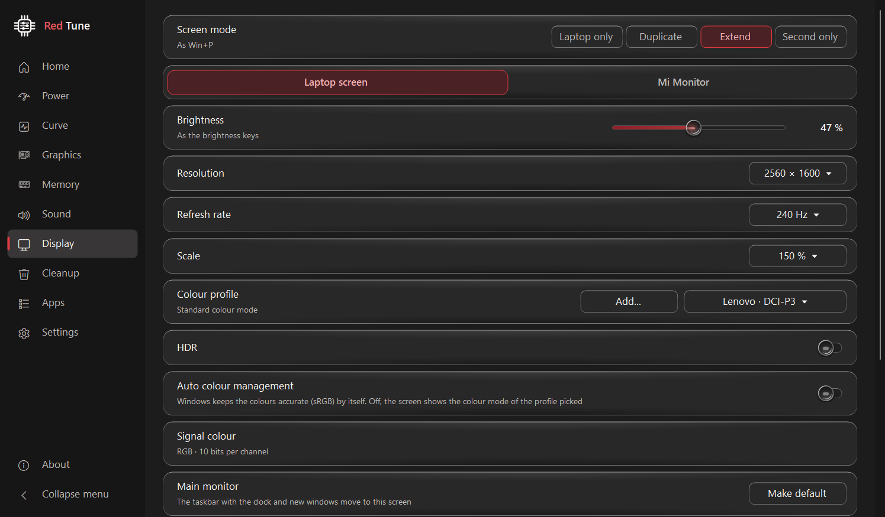

### Memory
Live timings and clocks, profiles, a memory test, and writing the memory speed and timings on machines whose BIOS exposes AMD's overclocking interface. Red Tune works out by itself what a machine allows, in three levels:

- **Verified** — the model and BIOS it was developed on: what was written is read back and compared.
- **Experimental** — any other AMD machine whose BIOS has the interface with commands for timings, and socketed DDR4 or DDR5 memory. The command numbers and the allowed ranges are taken from that machine's own BIOS. Writing is off until you switch on «Experimental writing» on the page; the consent is kept for that model and BIOS version. This path has not been run on a second machine yet.
- **View only** — no such interface in the BIOS, soldered (LP) memory, or a processor that is not AMD: the page shows the live values and says why it cannot write.

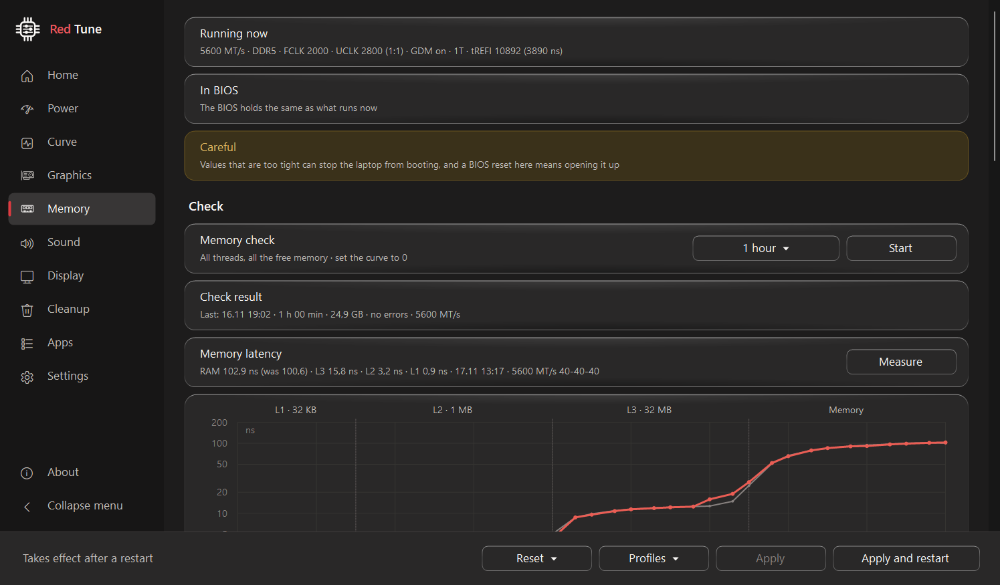

### Clean-up
- **Memory** — closes what was started after you signed in, as if the computer had just started: with a white list and a black list, a polite close first and a question before anything is forced.
- **Files on disk** — measures, then deletes only what you tick: temporary files, the Recycle Bin, update and browser caches, error reports, thumbnail and shader caches, crash dumps. Personal folders are never looked at.
- **Removing programs** — runs the program's own uninstaller, then finds what it left behind (folders, registry keys, shortcuts, startup entries). Files go to the Recycle Bin; registry keys are exported before they are deleted.

### Apps
- **Distribution** (processors with two chiplets) — pins programs to a chiplet by folder or process name: games on one, the background on the other. On an X3D processor the chiplet with 3D V-Cache is the game one. Games from the Steam, Epic, Xbox, EA, Ubisoft, GOG and Riot folders, and whatever a launcher starts outside its own folder, go to it without a rule of their own. A program without a rule that keeps the processor busy for a minute becomes a suggestion: the game chiplet if it was busy while on screen, the background one if not, all cores if it uses more than one chiplet has; one click takes it.
- **Startup** — everything that starts with Windows in one list: Run keys, startup folders, scheduled tasks, packaged apps.

### Settings
- **General** — language, interface scale, start with Windows, close to the tray, expert functions; what the mini panel shows; notifications; the overlay.
- **Device** (laptops with a supported firmware interface) — **Lenovo**: keyboard backlight, charging mode, USB power while asleep, the graphics card's working mode and the Fn keys. **ASUS**: the performance mode (quiet, balanced, performance), the battery's charge limit, the keyboard backlight, the Fn lock and the fan speeds, each only where the laptop's firmware has it. Written from the report of one model (Vivobook Pro 14 OLED M3401) and not yet tried on a real ASUS laptop.
- **Components** — what Red Tune found on this machine, what each part needs, and a system report you can copy when asking for a model to be supported.

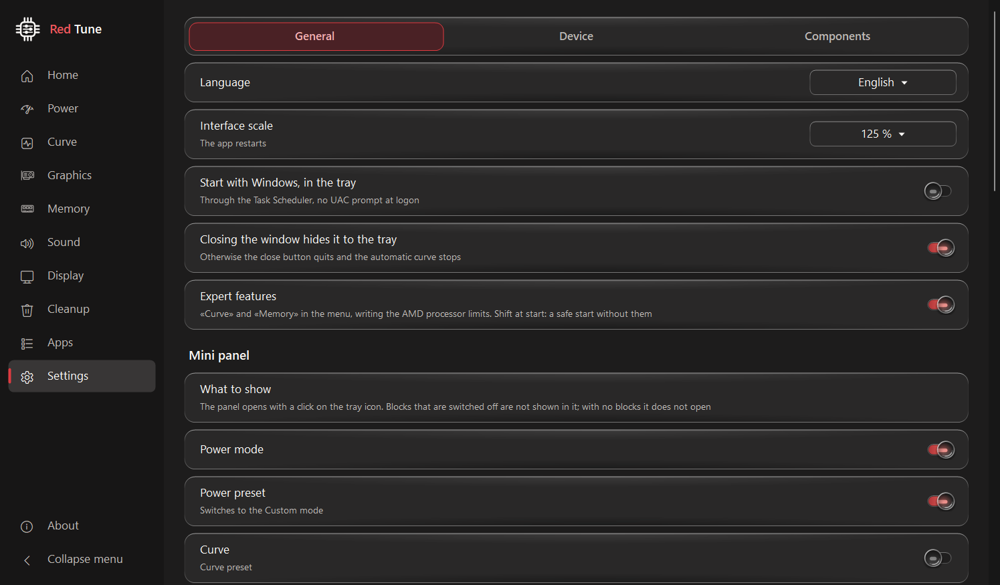

### Around the window
- **Mini panel** — a click on the tray icon opens small glass blocks: power mode, power preset, curve, graphics preset, output device, overlay, memory clean-up, displays off.
- **Notifications** — an on-screen note when the power mode, a Fn key, Caps Lock and the like change; position, duration and look are yours to set.
- **Overlay** — frame rate, temperatures and clocks of the processor and the graphics card in a corner of the screen over games.

## How it works

- **One program, no service.** A single executable for .NET Framework 4.8 (part of Windows 10 and 11) plus two small native libraries of its own: the load for the auto-tune and the sound effect. A scheduled task starts it in the tray when you sign in, if you ask for that.
- **The processor** is reached through the [PawnIO](https://pawnio.eu/) driver: Red Tune talks to the processor's system management unit to read the power table and to write the voltage curve and the power limits. PawnIO's own signed installer comes with Red Tune and is run when the driver is missing (by the setup, or by «Install» on the «Components» page); without the driver everything except those parts still works.
- **Laptop firmware.** Where a laptop's firmware offers a management interface in Windows (Lenovo's WMI classes, ASUS's system control driver), Red Tune uses it for power modes, limits, fans and device settings. Without one, those rows are hidden and the processor limits go the direct way.
- **Windows power plans** are read and written through Windows' own power API. Changes in the plan block wait for a button; nothing is written while you are still choosing.
- **The graphics card** is tuned through NVIDIA's own driver interfaces.
- **Sound** is an audio processing object: the kind of plug-in Windows' audio engine loads for a device. Red Tune registers it, places it in the device's chain of effects, and talks to it through a small shared file (settings in, meters and a spectrum back). The processing takes about one to two percent of a single processor core for the output and two to six percent for a full microphone chain (DeepFilterNet being the heavy part). The page's live pictures repaint only what the sound moves, and nothing that is scrolled out of view.
- **Memory timings** are read from the processor's registers and written through AMD's overclocking interface in the BIOS, where it exists.
- **No network.** Red Tune does not connect to the internet. The only links (PawnIO, Prime95) open in your browser when you click them.

### Safety nets
- **Safe start.** Hold **Shift** at start, or run with `--safe`: nothing is applied. If the previous start broke off within three minutes of applying (a freeze, a blue screen), the next one applies nothing either. Home then shows a banner with «Apply now».
- **Expert functions.** The curve, memory timings and direct processor limits are hidden until you switch them on in Settings and confirm.
- **Values the hardware did not report are never written** just because a slider stood somewhere: such sliders read «do not change».
- **Other tuning programs.** Red Tune warns when a program that changes the same settings starts with Windows: two of them would fight.

## Requirements

- Windows 10 or 11, 64-bit; administrator rights.
- An AMD Ryzen processor. Intel is not supported.
- [PawnIO](https://pawnio.eu/) for the curve, the direct processor limits and the processor temperature (its installer comes with Red Tune).
- An NVIDIA card for the «Graphics card» page.
- Prime95 is optional: the auto-tune has a load of its own.

## Install

1. Download `RedTune-Setup-x.y.z.exe` from [Releases](../../releases).
2. The installer is not code-signed, so Windows shows «Windows protected your PC»: choose **More info → Run anyway**.
3. If PawnIO is missing, the installer puts it in too (the task «Install the PawnIO driver», on by default), with PawnIO's own signed installer.

**Uninstall** from Windows' «Installed apps». It removes the sign-in task, takes the sound effect off every device and unregisters it, and asks whether to keep your settings.

**Where things are kept:** settings, presets, curves and the journal in `%APPDATA%\RedTune`; the sound effect's registered copy in `%ProgramFiles%\RedTune\Audio` and its shared file in `%ProgramData%\RedTune`.

## Languages

English, Spanish, Portuguese (Brazil), Russian, Simplified Chinese, Korean, Thai, Vietnamese and Indonesian (Settings → Language). A first start follows the language of Windows. The interface is written in Russian and translated; all translations except English are machine translations that no native speaker has reviewed yet — corrections are welcome (`tools\lang`).

## Status

Red Tune is developed and tested on one laptop: a Lenovo Legion R7000P with a Ryzen 9 8945HX and an RTX 5070 Laptop. On other machines it works out what is available and hides the rest, but writing the curve and the limits on other Ryzen families, the generic mode for other brands and for desktop PCs, and the sound effect on other audio drivers have not been verified on real hardware. The system report (Settings → Components → «Copy the report») is what helps to add a model.

## Build from source

You need the Roslyn C# compiler from Visual Studio or the Build Tools, a C/C++ compiler for the two native libraries (the built ones are kept in `native\`, so the program builds without it), and [Inno Setup 6](https://jrsoftware.org/isinfo.php) for the installer.

```powershell
.\build.ps1              # the program in bin\
.\build.ps1 -Installer   # and dist\RedTune-Setup-<version>.exe
```

The sound effect has a test bench that runs on every build of it; a library that fails a check is not kept.

Checks that write nothing to the hardware:

| Command | What it does |
|---|---|
| `RedTune.exe --hw-report out.txt` | what was found on this machine |
| `RedTune.exe --page-png <page> out.png` | a page drawn off screen (`RT_HW_SIM=cores8,nolenovo,…` pretends to be other hardware) |
| `RedTune.exe --lang-check out.txt` | how much of the interface each language covers |
| `RedTune.exe --comp-graph-check out.txt`, `--eq-strips-check`, `--motion-check`, `--sound-undo-check`, `--ui-edit-check` | the interface driven by mouse messages in a window of its own |
| `RedTune.exe --simulate-tune …` | the auto-tune against a made-up processor |
| `RedTune.exe --fan-check out.txt` | the fan curves' logic against made-up temperatures |
| `RedTune.exe --display-check out.txt` | every screen as Windows reports it: modes, colour, profiles, brightness |
| `RedTune.exe --dist-check out.txt` | where programs land on the chiplets and what the suggestions offer |
| `RedTune.exe --motion-frames out.txt` | how smoothly rows come and go |

Translations: `tools\lang` holds the scripts and the translated texts (`tr\<code>.json`); `node build.js <repo>` writes `lang\<code>.txt`, which the build embeds.

## License

GPL-3.0 — see [LICENSE](LICENSE). The three third-party files that ship with Red Tune, and the open projects it learned the hardware's interfaces from, are listed with their licenses in [THIRD-PARTY.md](THIRD-PARTY.md).
